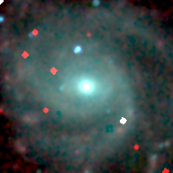

# Challenge coverage — sphere360 2.1.0

Prepared 15 November 2026 UTC. This records implemented behavior and actual checks; it does not certify discoveries or complete archive coverage.

| Challenge item | Implementation and evidence |
| --- | --- |
| Public-facing web tool | Existing Render service; this update is delivered as a PR for the owner to merge/deploy. No deployment is implied by local validation. |
| Enter arbitrary RA/Dec | Decimal ICRS coordinates, with range checks; name/sexagesimal lookup also available. Atlas can pan beyond any selection and display the entire sphere. |
| Display SPHEREx images | Real IRSA SIA2/TAP metadata and FITS IMAGE cutouts; common north-up grid, dates, load-gated playback, stepping and retry. No generated or bundled example replaces unavailable data. |
| Watch changes over time | Chronological timeline, displayed time span, UTC date windows, and combined immutable sequences. Side-by-side/blink comparison uses a common intensity scale. |
| Test the five requested targets | Live metadata and two actual science cutouts rendered for every field; table below. Target identification/motion/variability is not automatically established. |
| New observations/releases | Live queries and refresh pick up new observations in configured releases. New release IDs need configuration/code maintenance; automatic release discovery is not implemented. |
| Use the 102 infrared channels | D1–D6 selection, actual local spectral-WCS wavelength/channel width, wavelength-aware comparison and user-selectable three-band color. Six detectors are not 102 individually selectable spectral bins. No complete spectrum is claimed. |
| Add/subtract images | Two-image mean and signed difference, with common coverage and local wavelength checks. This is a quick-look operation, not weighted multi-exposure coaddition or PSF-matched subtraction. |
| Adjustable field | 1, 2, 3, 6 or 12 arcminute science cutouts; atlas zoom is independent. |
| Other telescope information | Gaia DR3 catalog overlay is implemented, with approximate proper motion. Its live service returned 502 during this check. DSS/2MASS/AllWISE are separate reference atlas layers; there is no registered WISE overlay on the SPHEREx frames. |
| URL queries / embedding | Coordinates, dates, detector, atlas view and combined date windows are shareable. The app was loaded inside an iframe in Chromium. Original product IDs/URLs can be saved for exact provenance because future live samples can change. |
| Metadata / contamination | Exact dates, detector, center wavelength/channel width, processing version, finite coverage and any-nonzero flag fraction. Original FITS gives full FLAGS/VARIANCE extensions. Status bits are not silently interpreted as contamination. |
| Spectra | Not implemented. The exploratory brightness proxy is not a spectrum or calibrated light curve. |

## Actual live target checks

These are observation samples returned during the check, not a survey inventory. Successful searches followed intermittent 502s for some queries.

| Target field | Detector / field | Inspected observation dates | Image result / limits |
| --- | --- | --- | --- |
| Barnard's Star | D2 / 12′ | 21 and 29 August 2025 | Two real PNGs + FITS metadata, HTTP 200. First frame has about 70% finite coverage. Finding coordinates are not propagated ephemerides; this short baseline is not a demonstrated proper-motion measurement. |
| Epsilon Indi B | D2 / 6′ | Two exposures on 24 April 2025 | Both real images, HTTP 200; essentially complete finite coverage. No claim to resolve the close brown-dwarf pair or identify it from these cutouts alone. |
| WISE 0855 | D6 / 12′ | May and November 2025 | Real images, HTTP 200. An additional November query expanded a combined sequence to 19 records spanning 192.88 days. Faint/noisy single frames are not a demonstrated detection. |
| RW Aurigae | D2 / 3′ | Two exposures on 8 September 2025 | Both real images and metadata, HTTP 200 after retry. About six minutes apart; not a useful measured variability baseline by itself. |
| R Draconis | D2 / 3′ | 8 and 15 June 2025 | Both real images, HTTP 200. A saturated/missing central region remains a gap; finite coverage elsewhere does not make the core usable for photometry. |

## Live comparison example

The WISE 0855 field was compared using real D6 exposures at 4.86093 µm (5 May 2025) and 4.87270 µm (14 November 2025), 192.7413 days apart. The center wavelengths and retained pixels pass the half-narrower-channel-width criterion. About **52.12%** of the field survives the combined finite/spectral mask. The rest remains transparent, including areas with incompatible local wavelengths. A/B use a shared scale; difference and two-image mean render successfully. Numeric difference FITS and source JSON download successfully. This is validation of the calculation, not proof of source motion.

## Live color example

The in-app M101 example uses **D6 → red (4.99384 µm, 11 May), D2 → green (1.61806 µm, 10 May), D1 → blue (0.99057 µm, 22 May 2025)**. About **99.85%** of pixels have finite data in all three channels. The time span is **11.95 days**; the mixed-date option was explicitly selected. The image is a qualitative false-color composite, not a simultaneous exposure or a color movie. It was made through the live app from IRSA FITS, without mocked science responses. D3 searches were intermittent, so the documented live check used the supported D2 green-channel option.

Exact source URLs, dates, wavelengths, channel limits and derived-product settings are retained in [the validation record](validation-2.1.0.json). These documentation files are not used by runtime searches or images.

## Remaining scientific limits

Limited metadata samples can miss useful epochs or wavelength matches. Flagged pixels are retained; images lack PSF matching and propagated uncertainties. Apparent changes can reflect wavelength, noise, foregrounds, saturation, alignment or processing differences. Full 102-channel spectra, calibrated light curves, weighted multi-image coadds, color playback and an automated discovery classifier remain future work. Gaia's live availability remains unverified for this release after the observed 502 response.
